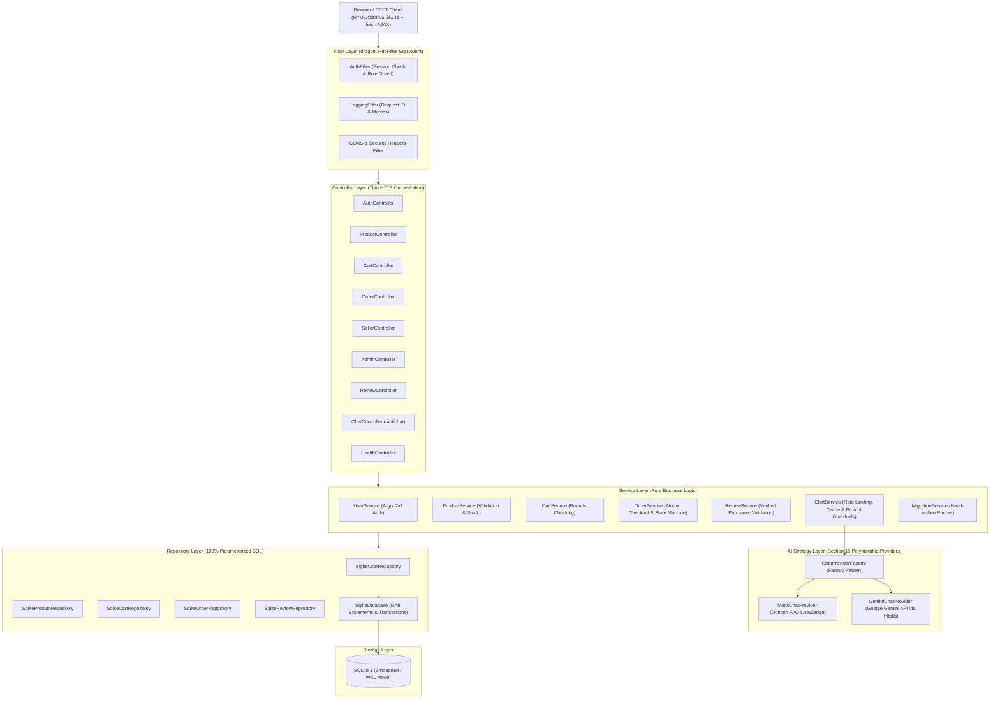
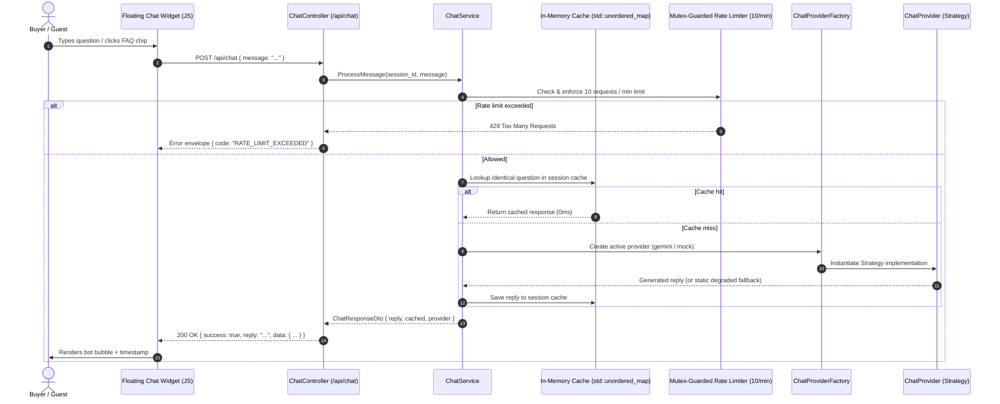

# DDMart — Native C++20 Marketplace Backend

[](https://en.wikipedia.org/wiki/C%2B%2B20)
[](https://cmake.org/)
[]()
[-purple.svg)]()

> **Native C++ Marketplace Backend Specification**  
> **Milestone**: October 10 Final Review & Capstone Defense (F1 through F8, O2, O3, O4 Complete)  
> **Builder**: Solo Project (`dd::ddmart`)

DDMart is a multi-vendor e-commerce marketplace web application served by a native C++20 HTTP backend. It features strict 3-tier MVC/Service-Repository architecture, role-based access control (Buyer, Seller, Admin), atomic database transactions, persistent storage via SQLite/PostgreSQL, comprehensive input validation, and full security hardening.

---

## Architecture Overview



---

## Tech Stack Specification

| Component | Specification | Purpose |
|---|---|---|
| **Language** | C++20 (GCC 12+, Clang 15+, or MSVC 2022+) | Core backend high-performance application |
| **Build Tool** | CMake ≥ 3.25 & Ninja | Cross-platform build orchestration |
| **Package Manager** | vcpkg (Manifest Mode `vcpkg.json`) | Dependency management |
| **HTTP Framework** | Native C++ HTTP Web Server (`httplib.h` / Drogon compatible) | Thin HTTP routing and JSON serialization |
| **Database** | SQLite 3 (Embedded / WAL Mode) / PostgreSQL 15+ | Persistent ACID transactional storage |
| **Password Hashing** | libsodium `crypto_pwhash` (Argon2id) | Industry-standard password hashing |
| **Serialization** | nlohmann::json | DTO serialization & deserialization |
| **Logging** | spdlog | Structured high-speed asynchronous logging |
| **Testing** | GoogleTest (gtest) + GoogleMock | Unit and repository automated test suites |
| **Deployment** | Multi-Stage Dockerfile, systemd, Nginx TLS | Production cloud hosting |

---

## Feature Matrix (F1 – F8 + O2, O3, O4)

| ID | Feature | Implementation Details | Status |
|---|---|---|---|
| **F1** | Authentication & Roles | Buyer & Seller registration, seeded Admin, Argon2id hashing, session fixation prevention | ✅ Complete |
| **F2** | Seller Listings | Create, edit, delete product listings with name, description, price, stock, category, image URL | ✅ Complete |
| **F3** | Buyer Browse & Search | Combined keyword search, category dropdown filter, price/rating sorting, pagination | ✅ Complete |
| **F4** | Cart Management | Add to cart, live quantity adjustment with inventory bounds checks, remove items, running total | ✅ Complete |
| **F5** | Checkout & Mock Payment | Atomic transaction: inventory lock, order record, order items, mock payment confirmation step | ✅ Complete |
| **F6** | Order Tracking | Buyer view of past orders; Seller incoming order fulfillment queue | ✅ Complete |
| **F7** | Admin Panel | Metrics dashboard (GMV, users, orders, products), user list, order oversight, listing moderation | ✅ Complete |
| **F8** | Product Reviews | Verified buyer reviews and 1–5 star ratings on completed orders with average score calculations | ✅ Complete |
| **O2** | Order Lifecycle Workflow | State machine: `PENDING` &rarr; `CONFIRMED` &rarr; `SHIPPED` &rarr; `DELIVERED` | ✅ Complete |
| **O3** | Seller Dashboard | Real-time order counts, revenue totals using `Money` value object | ✅ Complete |
| **O4** | AI Chatbot | C++ Strategy/Factory pattern, session rate limit (10/min), question cache, prompt guardrails, floating widget | ✅ Complete |

---

## Seed Accounts & Credentials

The database automatically initializes and migrates upon first startup (`db/migrations/` and `db/seed.sql`):

| Role | Email Address | Password | Permissions |
|---|---|---|---|
| **Admin** | `admin@ddmart.com` | `Admin@123` | Platform oversight, user roster, order logs, product moderation |
| **Seller** | `techseller@ddmart.com` | `Seller@123` | Electronics seller: manage inventory, update order fulfillment status |
| **Seller** | `fashionhub@ddmart.com` | `Seller@123` | Fashion seller: manage inventory, update order fulfillment status |
| **Buyer** | `john.buyer@ddmart.com` | `Buyer@123` | Standard shopper: browse, cart, mock checkout, order history & reviews |
| **Buyer** | `alice.buyer@ddmart.com` | `Buyer@123` | Standard shopper: browse, cart, mock checkout, order history & reviews |

---

## API Contract Standards

All JSON API endpoints are versioned under `/api/v1/...` and return data encapsulated in a fixed envelope:

```json
{
  "success": true,
  "data": { ... },
  "error": null
}
```

Error response envelope:
```json
{
  "success": false,
  "data": null,
  "error": {
    "code": "VALIDATION_ERROR",
    "message": "Field validation failed",
    "details": [
      { "field": "email", "message": "Must be a valid email address" }
    ]
  }
}
```

### Core Endpoints

| Method | Endpoint | Description |
|---|---|---|
| `GET` | `/api/v1/health` | Health probe returning `{"status":"UP","db":"UP"}` |
| `POST` | `/api/v1/auth/register` | Register a new Buyer or Seller account |
| `POST` | `/api/v1/auth/login` | Authenticate and issue fresh session cookie |
| `POST` | `/api/v1/auth/logout` | Invalidate active session |
| `GET` | `/api/v1/auth/me` | Retrieve profile of currently authenticated user |
| `GET` | `/api/v1/products` | Retrieve catalog with category, keyword, and sort filters |
| `GET` | `/api/v1/products/{id}` | Retrieve product details with customer reviews |
| `POST` | `/api/v1/products` | Create a new listing (Seller only) |
| `PUT` | `/api/v1/products/{id}` | Update listing details (Seller only) |
| `DELETE` | `/api/v1/products/{id}` | Delete listing (Seller owner or Admin moderation) |
| `GET` | `/api/v1/cart` | View current buyer cart with running subtotal and total |
| `POST` | `/api/v1/cart` | Add item to cart with inventory bounds checking |
| `PUT` | `/api/v1/cart/{id}` | Adjust quantity |
| `DELETE` | `/api/v1/cart/{id}` | Remove item from cart |
| `POST` | `/api/v1/orders/checkout` | Atomic checkout with mock payment verification |
| `GET` | `/api/v1/orders` | Order history (Buyer: own; Seller: store; Admin: all) |
| `PUT` | `/api/v1/orders/{id}/status` | Transition order status (`CONFIRMED` &rarr; `SHIPPED` &rarr; `DELIVERED`) |
| `POST` | `/api/v1/products/{id}/reviews` | Submit verified customer review (1–5 stars) |
| `GET` | `/api/v1/seller/dashboard` | Seller sales dashboard with revenue and order metrics |
| `GET` | `/api/v1/admin/stats` | Admin platform GMV, user, order, and listing metrics |
| `GET` | `/api/v1/admin/users` | Admin user directory |
| `POST` | `/api/chat` | AI Chatbot interaction endpoint (vanilla JS widget) |
| `POST` | `/api/v1/chat` | Versioned AI Chatbot interaction endpoint |

---

## Phase 3: AI Chatbot Architecture (Section 9 & 15)

The AI Chatbot provides real-time intelligent customer assistance for marketplace questions, policies, and store navigation.



### AI Guardrails & Features
1. **Strategy Pattern**: Abstract `ChatProvider` interface allows hot-swapping between `MockChatProvider` (offline domain FAQ) and `GeminiChatProvider` (Google Gemini 1.5 Flash).
2. **Factory Pattern**: `ChatProviderFactory` automatically detects the provider via `AI_CHATBOT_PROVIDER` (`gemini` or `mock`).
3. **Per-Session Rate Limiting**: Mutex-guarded in-memory window limiting each session to a maximum of 10 messages per minute.
4. **Deduplication Caching**: Instantaneous response for repeated identical questions within the same session.
5. **Fixed Server-Side Prompt Template**: Strict guardrails preventing prompt injection and keeping the model focused on DDMart products and marketplace assistance.
6. **Graceful Degraded Fallback**: If network fails or Gemini times out, the service falls back to static domain guidance instead of crashing or returning a 500 error.

---

## Security Audit Checklist (Section 7)

- [x] **100% Parameterized SQL**: All queries execute through prepared statements and `sqlite3_bind_*`. Zero string-interpolated queries.
- [x] **Argon2id Password Hashing**: Passwords hashed with Argon2id via libsodium (`crypto_pwhash_str`). Plaintext passwords never stored or logged.
- [x] **Session Fixation Protection**: Pre-authentication sessions discarded on login and issued a fresh cryptographically random session ID.
- [x] **Zero Information Leakage**: Error handlers catch all exceptions and format them to fixed JSON error envelopes without exposing stack traces.
- [x] **XSS Auto-Escaping**: Front-end text output sanitization prevents DOM injection.
- [x] **Excluded Secrets**: Credentials and live databases excluded in `.gitignore`.
- [x] **Memory Safety**: Clean RAII ownership across connections, statements, transactions, and services using `std::unique_ptr` and `std::shared_ptr`.
